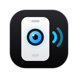

<p align="center">
  
</p>

<h1 align="center">Capturazo</h1>
<p align="center">Tu celular como cámara y micrófono de la computadora.<br>
Escanea un QR, elige la cámara (frontal, trasera, gran angular…) y el micrófono<br>
(normal o con reducción de ruido) y úsalos en tus videollamadas, fotos y grabaciones.</p>
<p align="center"><sub>Creado por <b>Miguel Mogrovejo</b> · v1.0.1 · hermano de <a href="https://github.com/mjmc4498/mando">Presentazo</a> y <a href="https://github.com/mjmc4498/botonazo">Botonazo</a></sub></p>

---

## Funciones

| | |
|---|---|
| **Cámara del celular** | Elige cualquier cámara del celular: frontal, trasera, gran angular, ultra gran angular o teleobjetivo (con nombres claros también en Android). Calidad de 480p, 720p o 1080p a 24, 30 o 60 cuadros, botón para girar entre frontal y trasera, linterna si el celular la tiene y vista previa en espejo. |
| **Micrófono** | Modo **Reducción de ruido** (supresión de ruido, cancelación de eco y control de volumen del celular) para hablar, o **Normal** (sin filtros) para música y sonido ambiente. Elige el micrófono del celular o unos audífonos conectados a él, con medidor de nivel. |
| **En las videollamadas** | El celular aparece como **«Capturazo · Cámara del celular»** y **«Capturazo · Micrófono del celular»** en la lista de dispositivos de los sitios que actives. La llamada no se corta si el celular se reconecta, cambia de cámara o la apaga: el sitio ve una imagen de espera. Opciones para *preferir el celular* y para *usarlo si falta la cámara*. |
| **Fotos y video** | Foto tomada con el celular a su resolución, guardada al instante en Descargas › Capturazo (JPG o PNG). Grabación con el sonido del celular en MP4 o WebM. Se piden desde el celular, el panel o el visor. |
| **Visor** | La cámara a pantalla completa en una pestaña o ventana: espejo, girar, llenar, controles que se ocultan solos (ideal para la captura de ventana de OBS), escuchar el micrófono y enviarlo a otra salida de audio. |
| **Control remoto** | Desde la computadora: cambiar de cámara, encender o apagar cámara y micrófono y elegir el modo del micrófono, sin tocar el celular. |
| **Conexión** | WebRTC directo y cifrado; retransmisión de Cloudflare para redes restrictivas; reconexión automática; código QR nuevo en cada sesión; varios celulares a la vez (eliges cuál está al aire). |

Probado de principio a fin con **43 comprobaciones automáticas** (extensión + celular reales conectados por PeerJS, con cámara y micrófono simulados por Chrome, una videollamada de prueba, foto, grabación, visor y reconexión).

## Cómo funciona

```
┌──────────────── Chrome (computadora) ────────────────┐          ┌──────── Celular ────────┐
│                                                       │          │                         │
│  popup.html ── QR, vista previa y controles           │   QR     │  remote/ (GitHub Pages) │
│  visor.html ── la cámara a pantalla completa          │ ───────▶ │  getUserMedia: cámara   │
│      │                                                │          │  y micrófono elegidos   │
│      ▼                                                │  WebRTC  │          │              │
│  offscreen.html ── PeerJS (anfitrión): recibe la      │ ◀══════  │  PeerJS (cliente)       │
│      cámara y el micrófono, graba y guarda fotos      │ cifrado  │  envía video y sonido   │
│      │                                                │          └─────────────────────────┘
│      ▼  WebRTC local (sin servidores)                 │
│  content/isolated.js ── puente en cada sitio activado │        Señalización: 0.peerjs.com
│  content/main.js ── «Capturazo · Cámara del celular»  │        (solo para conectar; no ve
│      en enumerateDevices y getUserMedia               │         el video ni el sonido)
└───────────────────────────────────────────────────────┘
```

- **Cámara y micrófono en las páginas.** `content/main.js` se registra (solo en los sitios permitidos) antes que la página y agrega dos dispositivos a `navigator.mediaDevices.enumerateDevices()`. Si la página pide `capturazo-camara` o `capturazo-microfono` en `getUserMedia`, recibe pistas propias (`MediaStreamTrackGenerator`) que se alimentan cuadro a cuadro con la señal del celular (`MediaStreamTrackProcessor`), con marcas de tiempo propias. Así la pista del sitio sigue viva aunque el celular se reconecte o cambie de cámara, y mientras no hay señal muestra una imagen de espera.
- **Reparto local.** El documento offscreen es el centro: recibe la llamada del celular y abre una conexión WebRTC local con cada página que la usa, con el visor y con el panel (`lib/relay.js`, señalización por `chrome.runtime.connect`). La conexión local empieza directamente en alta calidad (`x-google-start-bitrate`) y no sale de la computadora.
- **Del mundo aislado a la página.** La conexión local vive en el mundo aislado del script de contenido (las páginas suelen envolver `RTCPeerConnection`). El `MediaStream` pasa a la página a través de un elemento `<video>` compartido por los dos mundos (`MouseEvent.relatedTarget`).
- **El celular** cambia de cámara o de modo de micrófono con `RTCRtpSender.replaceTrack`, sin renegociar. Al apagar la cámara o el micrófono se detiene el dispositivo (se apaga la luz de la cámara) y no viaja nada.
- El QR contiene `https://…/capturazo/#id=<sesión>&k=<clave>`. La clave viaja en el fragmento `#` (nunca llega a un servidor) y el celular la borra de la barra de direcciones al conectarse.
- **El acceso a los sitios es opcional** y se da sitio por sitio con «Activar» en el panel (o para todos en los ajustes). El paquete no declara permisos de host. Al activar un sitio, sus pestañas abiertas reciben los scripts al instante y se avisa a la página (`devicechange`) para que muestre el celular sin recargar.
- El celular y el panel muestran siempre **qué sitios usan la cámara** en ese momento.

### Baja latencia

Medido con `npm run test:latencia` (el «celular» dibuja la hora exacta en cada cuadro y la videollamada y el visor la leen al recibirlo): **unos 35–40 ms de punta a punta** a 30 cuadros por segundo, con el celular y la computadora en el mismo equipo. Es el piso que ponen las dos codificaciones del camino (celular → computadora y el reparto local) y el intervalo entre cuadros. Con un celular real se suma la red Wi-Fi; para que ese tramo agregue lo menos posible:

- **El video no espera al audio.** El audio del celular llega en su propio «stream»: si compartieran uno, Chrome retrasaría el video para sincronizarlo con el audio, que siempre lleva más búfer (en Wi-Fi, decenas de milisegundos).
- **Sin búfer extra al recibir** (`jitterBufferTarget = 0` en todos los receptores): cada cuadro se reenvía o se muestra apenas se decodifica.
- **H.264 primero** en el tramo del celular: los celulares lo codifican por hardware, más rápido y sin calentarse.
- **Audio en paquetes de 10 ms** (por defecto son de 20 ms).
- **Se mantienen los cuadros, no la resolución:** con poca red o poco procesador baja la resolución, pero la imagen no se atrasa. En la página, si el sitio se atrasa, se descartan los cuadros viejos (`maxBufferSize: 1`).
- **Arranque rápido:** las conexiones empiezan con buena calidad (`x-google-start-bitrate`) en vez de subirla de a poco.

Para la latencia más baja: celular y computadora en la misma red Wi-Fi (de preferencia 5 GHz), el modo de micrófono **Normal** si no hace falta quitar ruido (el procesamiento de voz suma unos milisegundos) y 30 cuadros por segundo (60 solo si el celular y la computadora van sobrados).

## Estructura

```
capturazo/
├── extension/           ← lo que se empaqueta y sube a la Chrome Web Store
│   ├── manifest.json
│   ├── background.js    service worker: sesión, scripts por sitio, fotos y videos
│   ├── offscreen.*      conexión WebRTC con el celular, reparto local y grabación
│   ├── popup.*          panel con el QR, vista previa y controles
│   ├── visor.*          la cámara a pantalla completa
│   ├── options.*        bienvenida y ajustes
│   ├── content/         main.js (cámara y micrófono en la página) e isolated.js (puente)
│   ├── lib/             PeerJS, QR, relay.js (reparto local) e i18n
│   ├── _locales/        textos en español (se generan con scripts/textos.py)
│   └── icons/
├── remote/              ← página del celular (se publica en GitHub Pages)
│   ├── privacy.html     política de privacidad (URL pública para la tienda)
│   └── favicon.ico, icon.svg, manifest.webmanifest…
├── cloudflare/          ← Worker de credenciales TURN (opcional: se comparte el de Presentazo)
├── store/               ← imágenes y textos para la ficha de la tienda (LISTING.md)
├── design/              logos SVG, escena de demostración y composiciones de la tienda
├── presentacion/        presentación del producto (capturazo.pptx)
├── scripts/             build.sh, textos.py, render.py, demo-media.py, capture-store.mjs, presentacion.py
├── test/                prueba de punta a punta y videollamada de prueba
└── dist/                paquetes generados (.zip / .crx)
```

## Publicación paso a paso

### 1. Publica la página del celular (una sola vez)

El QR abre `https://mjmc4498.github.io/capturazo/`, así que esa página debe existir:

```bash
cd capturazo
git init -b main && git add . && git commit -m "Capturazo 1.0.0"
gh repo create mjmc4498/capturazo --public --source . --push
gh api -X POST repos/mjmc4498/capturazo/pages -f build_type=workflow
```

El flujo `.github/workflows/pages.yml` publica la carpeta `remote/` en cada cambio. En 1–2 minutos estarán disponibles:

- Celular: `https://mjmc4498.github.io/capturazo/`
- Privacidad: `https://mjmc4498.github.io/capturazo/privacy.html`

> ¿Otra dirección? Cambia `REMOTE_URL` en `extension/config.js` (y `homepage_url` en el manifiesto) y vuelve a empaquetar. También puede cambiarse en **Ajustes › Avanzado** sin reempaquetar.

### 2. Prueba la extensión en tu Chrome

1. Ejecuta `./scripts/build.sh`.
2. Abre `chrome://extensions`, activa **Modo de desarrollador** y pulsa **Cargar extensión sin empaquetar**.
3. Elige la carpeta `dist/capturazo/` (su ruta no cambia entre versiones).
4. Abre tu videollamada, haz clic en el ícono de Capturazo (o `Alt+Shift+C`), pulsa **Activar** para ese sitio y escanea el QR. En el celular toca **Empezar** y en la llamada elige «Capturazo · Cámara del celular» y «Capturazo · Micrófono del celular».

### 3. Empaqueta

```bash
./scripts/build.sh
```

Genera `dist/capturazo-<versión>.zip` para la tienda y la carpeta `dist/capturazo/` para «Cargar extensión sin empaquetar» (valida manifiesto, íconos, textos y scripts antes de comprimir).

> Si el Escritorio se sincroniza con iCloud, borrar y volver a crear archivos enseguida deja copias de conflicto (`_locales 3`, `popup 2.js`) y Chrome responde *«Filenames starting with "_" are reserved»*. Por eso `build.sh` actualiza el ZIP y la carpeta en su lugar, borra esas copias de `dist/` y se detiene si encuentra alguna dentro de `extension/`.

Para un `.crx` instalable fuera de la tienda: `./scripts/build.sh --crx` (la clave queda en `keys/capturazo.pem`; guárdala y no la subas a git). **La Chrome Web Store solo acepta el ZIP**; ella firma el paquete final.

### 4. Sube a la Chrome Web Store

1. Entra al [Panel del desarrollador](https://chrome.google.com/webstore/devconsole) (la misma cuenta de Presentazo y Botonazo; el registro de USD 5 ya está pagado).
2. **Nuevo elemento** → sube `dist/capturazo-1.0.1.zip`.
3. Completa las pestañas copiando los textos de [`store/LISTING.md`](store/LISTING.md) y sube las imágenes de `store/`.
4. **Enviar para revisión.** El acceso a los sitios es un permiso opcional que se pide en tiempo de ejecución, así que el paquete no declara permisos de host; las justificaciones de cada permiso ya están redactadas en `LISTING.md`.

### Nuevas versiones

1. Sube `version` en `extension/manifest.json` (y `VERSION` en `remote/app.js`, y el `?v=` de `remote/index.html` si cambió el celular).
2. Anota los cambios en `CHANGELOG.md`.
3. `./scripts/build.sh` y sube el nuevo ZIP en el panel (**Paquete › Subir nuevo paquete**).

## Usarlo fuera del navegador

- **OBS Studio y programas de transmisión:** abre el **visor** (pulsa H para ocultar los controles) y agrégalo como *Captura de ventana*. Con la **cámara virtual** de OBS, el celular sirve como cámara en cualquier programa de la computadora.
- **El micrófono en toda la computadora:** en el visor pulsa **Escuchar** y elige como salida un cable de audio virtual (por ejemplo, VB-CABLE en Windows o BlackHole en Mac). En el otro programa, elige ese cable como micrófono.

## Desarrollo

```bash
npm install                 # Puppeteer (solo para pruebas y capturas)
npm run serve               # servidor local en http://localhost:8767 (otra terminal)
npm run test:e2e            # prueba completa extensión ↔ celular ↔ videollamada (43 comprobaciones)
npm run test:latencia       # retardo real de punta a punta (videollamada y visor)
npm run demo-media          # cámara y micrófono simulados (test/out/media) desde design/demo/escena.html
npm run textos              # regenera _locales/es/messages.json desde scripts/textos.py
npm run icons               # regenera íconos y favicon desde design/*.svg
npm run store:capture       # capturas reales de la extensión y del celular
npm run store:images        # compone las imágenes de la tienda
npm run presentacion        # genera presentacion/capturazo.pptx (requiere python-pptx)
```

- Vista previa del celular sin computadora: `http://localhost:8767/remote/?demo` (añade `&start`, `&rec`, `&mode=normal`, `&camoff`, `&sheet=settings` o `&uses=reunion.example.com`).
- Prueba local con el celular: en **Ajustes › Avanzado** pon `http://<IP-de-tu-computadora>:8767/remote/` (misma red Wi-Fi). Ojo: fuera de `localhost` los navegadores solo dan la cámara en `https`, así que para probar con un celular real usa la página publicada.
- La prueba de punta a punta usa una copia de la extensión en la carpeta temporal del sistema (fuera de iCloud) con `host_permissions` para `http://localhost:8767` (el diálogo de permisos no se puede pulsar en modo headless), la cámara y el micrófono simulados de Chrome (`--use-file-for-fake-video-capture` / `--use-file-for-fake-audio-capture`, con `--disable-features=AudioServiceSandbox` para que el servicio de audio pueda leer el WAV) y otro contexto del navegador como «celular».

### Retransmisión con Cloudflare (redes restrictivas)

Capturazo comparte con Presentazo y Botonazo el Worker `https://mando-turn.mjmc4498.workers.dev`, que entrega credenciales temporales del servidor TURN de Cloudflare (gratis hasta 1.000 GB al mes, con pausa automática a los 900 GB). Acepta cualquier extensión de Chrome y el origen `https://mjmc4498.github.io`. **El video consume mucho más que los botones** (720p ≈ 1,1 GB por hora): casi siempre la conexión es directa (misma red Wi-Fi), pero si muchas sesiones pasaran por la retransmisión conviene un Worker propio. Consumo del mes: <https://mando-turn.mjmc4498.workers.dev/estado>.

La carpeta `cloudflare/` tiene una copia (`capturazo-turn`): `cd cloudflare && npx wrangler deploy`, guarda los secretos `TURN_KEY_ID`, `TURN_KEY_API_TOKEN` y `CF_ANALYTICS_TOKEN`, y cambia `ICE_ENDPOINT` en `extension/config.js` y `remote/app.js`.

## Permisos

| Permiso | Para qué |
|---|---|
| Sitios web (opcional: `https://*/*`, `http://*/*`) | Se pide sitio por sitio con «Activar» en el panel (o para todos en los ajustes) y se quita en **Ajustes › Dónde usar el celular**. Agregar la cámara y el micrófono del celular a la lista de dispositivos del sitio. |
| `activeTab` | Mostrar en el panel el sitio actual para activarlo con un clic. |
| `scripting` | Registrar los scripts solo en los sitios activados (e insertarlos en sus pestañas abiertas). |
| `offscreen` | Mantener la conexión WebRTC, repartir la señal dentro de la computadora y grabar el video. |
| `downloads` | Guardar fotos y videos en Descargas › Capturazo. |
| `storage` | Guardar los ajustes y la sesión. |

## Limitaciones

- La cámara del celular aparece en los **sitios web** de Chrome. Los programas de escritorio (Zoom, Teams o Discord instalados) no ven cámaras de una extensión: para ellos usa el visor con la cámara virtual de OBS, o un cable de audio virtual para el micrófono.
- iOS apaga la cámara cuando Safari pasa a segundo plano o se bloquea la pantalla: deja la página abierta (Capturazo mantiene la pantalla encendida) y conecta el celular al cargador. Al volver, la cámara se abre sola.
- El celular solo puede usar una cámara a la vez (así lo exigen iOS y la mayoría de los Android).
- La cancelación de eco del celular no conoce el sonido de la computadora: usa audífonos en la computadora para que el celular no capte la llamada.
- Chrome no permite extensiones en `chrome://` ni en la Chrome Web Store.
- La grabación larga se guarda en memoria hasta que la detienes (unos 3,6 GB por hora a 1080p y 2,2 GB a 720p): para grabaciones de varias horas, detén y vuelve a grabar de vez en cuando.

## Licencia

© 2026 Miguel Mogrovejo. Incluye PeerJS y QR Code Generator (MIT) e íconos basados en Lucide (ISC) — ver `extension/THIRD_PARTY_NOTICES.txt`.
